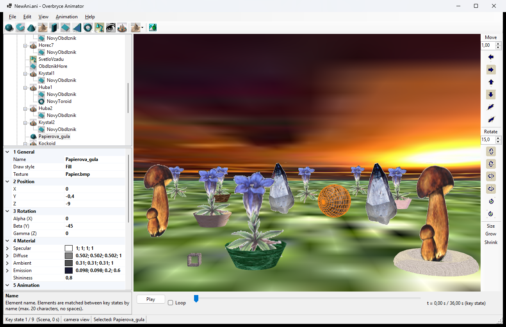
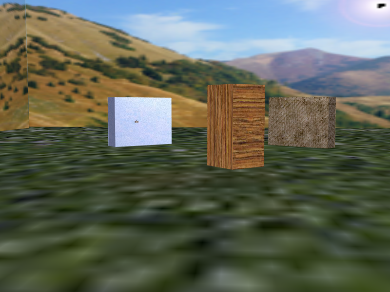
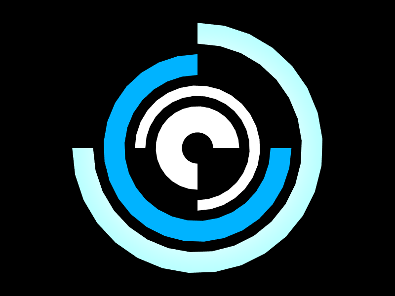
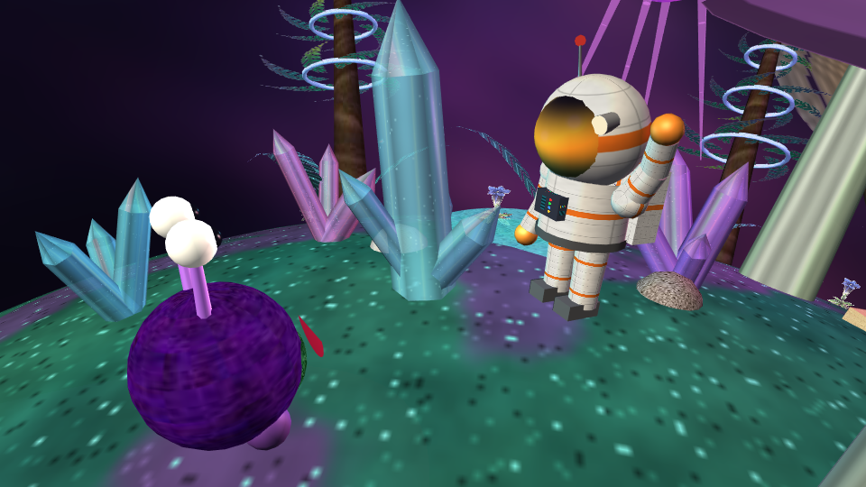

# Overbryce Animator 2.0

This is a key-frame 3D animation editor for current Windows, built on .NET 10 and OpenGL 3.3. It is a port of **Overbryce Animator 1.0**, written in 1998 by Tomáš Kopečný for the diploma thesis *Simulácia virtuálnej reality pomocou OpenGL – animácia scény*. The thesis was submitted at FEI STU Bratislava; the original program was built with Borland C++ Builder 3 and OpenGL 1.1.



The basic workflow:

1. Build a scene from primitives, groups, lights and cameras.
2. Copy it into **key states** at chosen times and change positions, angles, colours or shapes in each one.
3. Play the result. Overbryce interpolates every attribute with a time-aware Catmull-Rom spline, so motion stays smooth however unevenly the key states are spaced.
4. Export the frames to BMP or PNG files.

| | | |
|---|---|---|
|  |  |  |
| `ha1.ani` – textured scene | `Meshe.ani` – Bezier surfaces | `Disky.ani` – permanent rotation |

### New sample: Lumina

[samples/Lumina](samples/Lumina/README.md) is a 64-second animation made for the port, with up to 460 elements and hierarchies up to nine levels deep. It opens on a planetary system with nested orbits, where a lander shoots past the camera on its way in. On the moon, an astronaut lands among glowing fungi and crystals and meets one of the locals.



## Features

- **Elements:**
  - Shapes: sphere, disk, ring or sector, truncated cone, box, rectangle, triangle, torus, and Bezier mesh (with 4 presets).
  - Spot and point lights (up to 8) and cameras (up to 8, one active).
  - Nested groups.
- **Materials:** OpenGL material colours and shininess.
  - Textures from any bitmap; pure white is transparent when alpha blending is on.
  - The torus uses sphere-mapped texturing.
- **Animation:**
  - Non-uniform Catmull-Rom interpolation of every numeric attribute, matched by element name.
  - Per-element *Stop at this state*.
  - Permanent rotation and orbit.
  - Fog keyed per state.
- **Editor:**
  - Element tree with drag-and-drop between groups and key states.
  - Property grid.
  - **Click selection in the 3D view.**
  - Orbitable front, side and top views.
  - Timeline with live preview and real-time playback.
- **Output:**
  - Off-screen frame export at up to 1920×1080 with multisampling.
  - Command-line rendering of a single picture or of every frame.
- **Compatibility:** reads and writes the original `.ani` format, so files open in both programs.

## Requirements

- Windows 10 or 11 (x64)
- [.NET 10 SDK](https://dotnet.microsoft.com/download)
- A GPU with OpenGL 3.3

The project uses [OpenTK](https://opentk.net/) 4 and its WinForms `GLControl` (restored from NuGet).

## Build, run and test

Run these from the `Port` folder:

```powershell
dotnet build Overbryce.sln
```

```powershell
dotnet run --project src\Overbryce.App -- "..\DIP\SCENES\NewAni.ani"
```

```powershell
dotnet test tests\Overbryce.Core.Tests
```

The sample animations and textures in `..\DIP\SCENES` and in `samples` are copied to `Scenes\` next to `Overbryce.exe`. *File › Open* starts in that folder. The tests also read the samples from `DIP\SCENES`, so keep the `Port` folder next to `DIP`.

### Distributable build

This command makes a build that runs without .NET installed:

```powershell
dotnet publish src\Overbryce.App -p:PublishProfile=win-x64
```

It writes `out\dist\Overbryce\`, which contains:
- `Overbryce.exe`, a single self-contained file of about 53 MB;
- `Scenes\`, with all the samples and their bitmaps, Lumina included;
- [`README.txt`](src/Overbryce.App/Dist/README.txt), with the controls and the command line;
- `Lumina.cmd`, which opens Lumina.

To share it, zip that folder. Before you publish again, close any copy of `Overbryce.exe` that is running from it.

### Command line

```text
Overbryce.exe [file.ani] [--snapshot out.png] [--time seconds] [--view camera|front|side|top] [--wire] [--size WxH]
Overbryce.exe file.ani --frames folder [--from seconds] [--to seconds] [--view ...] [--wire] [--size WxH]
```

With `--snapshot`, Overbryce renders one picture and exits without opening the editor:

```powershell
Overbryce.exe Scenes\Gule.ani --snapshot gule.png --time 60 --size 800x600
```

With `--frames`, it renders every frame (or those between `--from` and `--to`) as `name000000.png`, `name000001.png`, … into the folder and exits:

```powershell
Overbryce.exe Scenes\Lumina\Lumina.ani --frames frames --size 1280x720
```

## Using the editor

| Action | Control |
|---|---|
| Select an object | **Click it in the 3D view**, or click it in the tree |
| Select the enclosing group | **Alt+click** (repeat to go further up) |
| Select the key state | Click the background |
| Orbit or zoom an editor view | Left-drag or mouse wheel (front, side and top views) |
| Camera, front, side or top view | Ctrl+1 … Ctrl+4 |
| Wire frame on/off | Ctrl+W |
| Previous or next key state | PgUp / PgDn (PgDn on the last state adds a copy 5 s later) |
| First or last key state | Ctrl+Home / Ctrl+End |
| Duplicate or delete the key state | Ctrl+D / Ctrl+Del |
| Rename or delete an element | F2 / Del |
| Make a camera the active one | Ctrl+K |
| Move an element to another group or state | Drag it in the tree (Ctrl+drag copies) |
| Play or stop | F5, or drag the timeline slider |
| Export frames | Ctrl+E (Esc cancels) |
| Show controls | F1 |

More about selection and the other tools:

- **Clicking in the 3D view** selects the object under the cursor.
  - Transparent parts of textures can be clicked through.
  - In wire-frame mode, light and camera icons can be clicked too.
  - During timeline preview, a click selects the object in the key state at or before the current time.
- **Tool bars** are the original button bitmaps.
  - The top bar inserts elements.
  - The right bar moves, rotates, grows and shrinks the selected element by a fixed step.
- **Export** writes `name000000.bmp`, `name000001.bmp`, … and a `list.lst` through the active camera. Set the size, antialiasing and format in *File › Rendering settings*.

## Project layout

| Path | Content |
|---|---|
| `src/Overbryce.Core` | UI-free model: elements, groups, key states, the animation, interpolation, transforms, and the `.ani` reader and writer |
| `src/Overbryce.App` | WinForms editor, the OpenGL renderer (a shader that emulates the GL 1.1 fixed-function pipeline), picking, and frame export |
| `tests/Overbryce.Core.Tests` | xUnit tests: loading all 7 original sample files and Lumina, save and reload with identical output, interpolation and camera maths |
| `samples/Lumina` | The Lumina animation and its textures |
| `tools/Lumina` | The generator that writes `samples/Lumina` through `Overbryce.Core` |
| `docs/` | Documentation |

The model classes follow the original ones:

| Original | Port |
|---|---|
| `CPrvok` | `Element` |
| `CGrupa` | `GroupElement` |
| `CScena` | `Scene` |
| `CAnimacia` | `Animation` |

## Documentation

- [docs/animation-model.md](docs/animation-model.md): how frames are computed, covering key states, element matching, the spline, stopping, permanent motion and the transform hierarchy.
- [docs/ani-format.md](docs/ani-format.md): the `.ani` file format.
- [docs/changes-from-1998.md](docs/changes-from-1998.md): bugs fixed in the port, behaviour that differs from the original, and what was kept on purpose.
- [docs/port-overview.md](docs/port-overview.md): how the port was made, in brief.
- [docs/thesis-evaluation.md](docs/thesis-evaluation.md): an evaluation of the 1998 thesis and its software, by the standards of its time.
