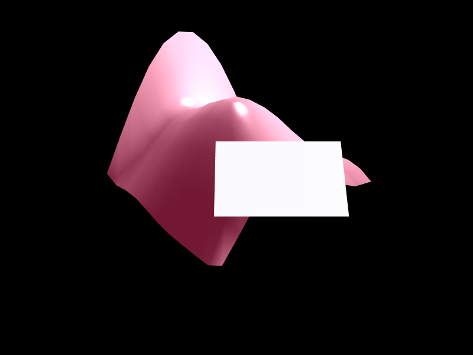
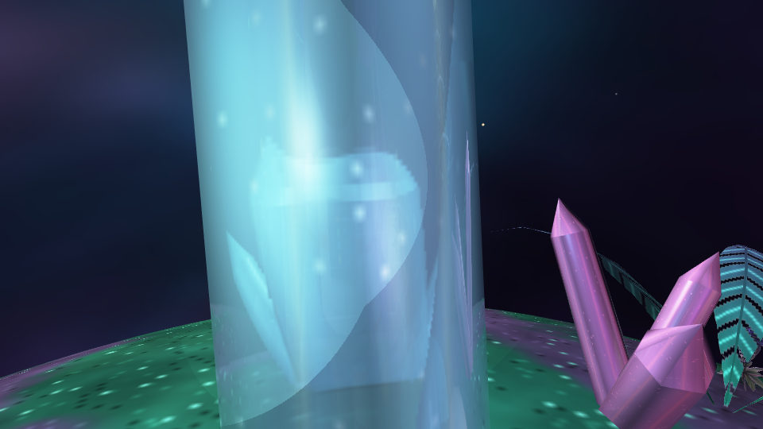
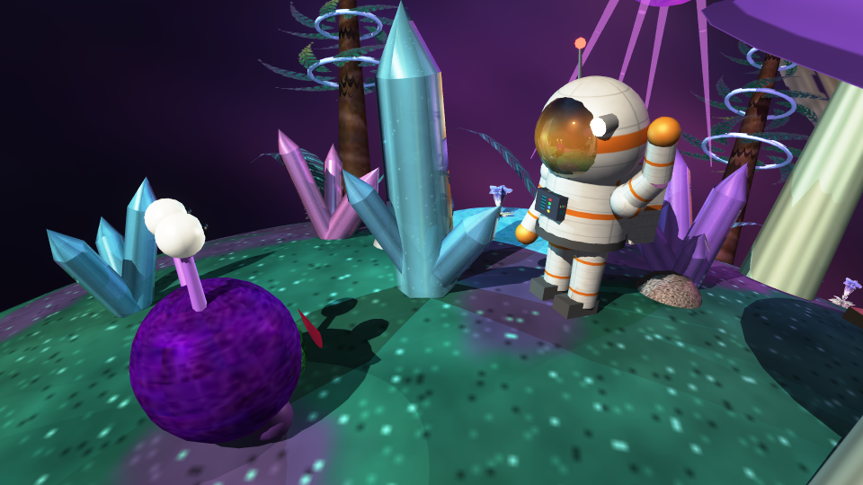
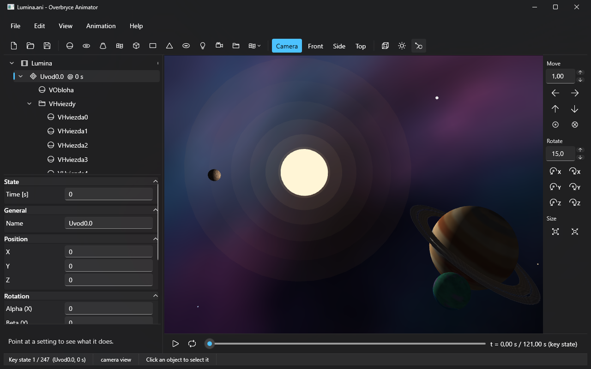

# Overbryce Animator 2.4

This is a key-frame 3D animation editor for current Windows, built on .NET 10 and OpenGL 3.3. It is a port of **Overbryce Animator 1.0**, written in 1998 by Tomáš Kopečný for the diploma thesis *Simulácia virtuálnej reality pomocou OpenGL – animácia scény*. The thesis was submitted at FEI STU Bratislava; the original program was built with Borland C++ Builder 3 and OpenGL 1.1.


The basic workflow:

1. Build a scene from primitives, groups, lights and cameras.
2. Copy it into **key states** at chosen times and change positions, angles, colours or shapes in each one.
3. Play the result. Overbryce interpolates every attribute with a time-aware Catmull-Rom spline, so motion stays smooth however unevenly the key states are spaced.
4. Export the frames to BMP or PNG files.

| | | |
|---|---|---|
|  |  |  |
| `ha1.ani` – textured scene | `Meshe.ani` – Bezier surfaces | `Disky.ani` – permanent rotation |

### New sample: Lumina

[samples/Lumina](samples/Lumina/README.md) is a 121-second animation made for the port, with up to 2,717 elements and hierarchies up to eleven levels deep. It opens on a planetary system with nested orbits, where a lander shoots past the camera on its way in. On the moon, an astronaut lands among glowing fungi and crystals and meets one of the locals, who leads him across the jungle to the ocean and down into an underwater canyon.


### New in 2.1: modern rendering

Next to the classic 1998 look there is now a modern renderer (View › Modern rendering, Ctrl+M) with:

- HDR lighting with bloom (textures keep the 1998 clamp of the light at 1, so the old scenes are not washed out);
- soft shadows from up to eight lights;
- ambient occlusion;
- reflections and refracting glass;
- glowing materials.

Elements get four new properties for it: *Reflectivity*, *Refractive index*, *Glow* and *Casts shadows*. They are stored after the end of the original file format, so the 1998 program and version 2.0 still open the files. See [Modern rendering](docs/modern-rendering.md).

| Classic | Modern |
|---|---|
|  |  |

### New in 2.2: ray tracing

An offline CPU ray tracer renders exported frames, snapshots and a preview window (View › Ray trace this view, F9). Compared with the modern renderer it adds:

- exact reflections, also glossy ones;
- glass that refracts and absorbs light;
- soft shadows from lights of a given size;
- depth of field and motion blur;
- smooth spheres, cones, disks and tori.

With its effects off, it renders the classic look within about one level in 255 on average. Elements get *Roughness* and *Absorption*, lights a *Light radius*, and cameras an *Aperture* and *Focus*. They are stored like the 2.1 additions, so older versions still open the files. See [Ray tracing](docs/raytracing.md).

| Modern | Ray traced |
|---|---|
|  |  |

### New in 2.3: a WPF editor

The editor window moved from Windows Forms to WPF with the Windows 11 (Fluent) look:

- light and dark themes, which follow Windows or can be chosen in View › Theme (the choice is kept in `%APPDATA%\Overbryce\settings.json`);
- line icons for the element types and Windows icon-font symbols in place of the 1998 bitmap buttons, drawn in the theme's colours;
- a property panel with collapsible categories, colour swatches with a colour picker, and the description of the setting under the pointer;
- a tree that builds the branch of a key state when it is opened, so animations with hundreds of key states open quickly.

The 3D view, the file format and the command line are unchanged.



### New in 2.4: import from Blender

*File › Import › Blender scene…* (or `--import-blender` on the command line) turns a `.blend` file into an animation. Blender, run in the background, reads the evaluated scene frame by frame: after modifiers, geometry nodes, rigs and simulations. Overbryce then builds the animation from that:

- **Geometry and hierarchy.** Meshes, curves and text become a new element type, the *polygon mesh*, stored in a `.meshes` file next to the `.ani`. Plain boxes and rectangles become Overbryce's own. Parents become groups.
- **Materials, lights and cameras.** Principled materials become Phong colours and the modern values, with their image textures. Lights get a falloff fitted to Blender's. Cameras keep their lens, clipping, depth of field and cuts.
- **World and settings.** The world becomes ambient light, a sky and fog. The render settings carry over.
- **Motion.** It is fitted with as few key states as the spline needs to stay within a tolerance. Shape keys and deformations become morphing meshes.
- **Report.** Whatever could only be approximated is listed in a report.

A scene exported to Blender by Overbryce comes back as the elements it was made from, with the edits made in Blender. The 1998 samples and Lumina render the same after the round trip. See [Import from Blender](docs/blender-import.md).

## Features

- **Elements:**
  - Shapes: sphere, disk, ring or sector, truncated cone, box, rectangle, triangle, torus, Bezier mesh (with 4 presets), and polygon mesh (imported from Blender).
  - Spot and point lights (up to 8) and cameras (up to 8, one active).
  - Nested groups.
- **Materials:** OpenGL material colours and shininess.
  - Textures from any bitmap; pure white is transparent when alpha blending is on.
  - The torus uses sphere-mapped texturing.
- **Animation:**
  - Non-uniform Catmull-Rom interpolation of every numeric attribute, matched by element name.
  - Per-element *Stop at this state*.
  - Permanent rotation and orbit.
  - Fog keyed per state.
- **Editor:**
  - Light and dark themes.
  - Element tree with drag-and-drop between groups and key states.
  - Property panel.
  - **Click selection in the 3D view.**
  - Orbitable front, side and top views.
  - Timeline with live preview and real-time playback.
- **Rendering:**
  - Classic: the OpenGL 1.1 look of 1998, emulated with shaders.
  - Modern: HDR, bloom, shadow maps, ambient occlusion, reflection probes, glass and glow.
  - Ray traced (offline, on all CPU cores): reflections, refraction, soft shadows, depth of field and motion blur.
- **Output:**
  - Off-screen frame export at up to 1920×1080 with multisampling, or ray traced.
  - Command-line rendering of a single picture or of every frame.
- **Compatibility:** reads and writes the original `.ani` format, so files open in both programs. The 2.1 and 2.2 additions go after the end of the original format, where older versions stop reading.

## Requirements

- Windows 10 or 11 (x64)
- [.NET 10 SDK](https://dotnet.microsoft.com/download)
- A GPU with OpenGL 3.3

The project uses [OpenTK](https://opentk.net/) 4 and its WinForms `GLControl` (restored from NuGet), which the WPF window hosts for the 3D view.

## Build, run and test

Run these from the `Port` folder:

```powershell
dotnet build Overbryce.sln
```

```powershell
dotnet run --project src\Overbryce.App -- "..\DIP\SCENES\NewAni.ani"
```

```powershell
dotnet test Overbryce.sln
```

The sample animations and textures in `..\DIP\SCENES` and in `samples` are copied to `Scenes\` next to `Overbryce.exe`. *File › Open* starts in that folder. The tests also read the samples from `DIP\SCENES`, so keep the `Port` folder next to `DIP`.

### Distributable build

This command makes a build that runs without .NET installed:

```powershell
dotnet publish src\Overbryce.App -p:PublishProfile=win-x64
```

It writes `out\dist\Overbryce\`, which contains:
- `Overbryce.exe`, a single self-contained file of about 53 MB;
- `Scenes\`, with all the samples and their bitmaps, Lumina included;
- [`README.txt`](src/Overbryce.App/Dist/README.txt), with the controls and the command line;
- `Lumina.cmd`, which opens Lumina.

To share it, zip that folder. Before you publish again, close any copy of `Overbryce.exe` that is running from it.

### Command line

```text
Overbryce.exe [file.ani] [--snapshot out.png] [--time seconds] [--view camera|front|side|top] [--wire] [--size WxH] [--modern|--classic] [--raytrace [--samples N] [--bounces N]]
Overbryce.exe file.ani --frames folder [--from seconds] [--to seconds] [--view ...] [--wire] [--size WxH] [--modern|--classic] [--raytrace [--samples N] [--bounces N]]
Overbryce.exe file.ani --blender folder [--no-blend]
Overbryce.exe scene.blend --import-blender out.ani [--static] [--axis auto|yup|zup] [--tolerance 0.001]
```

`--modern` and `--classic` choose the renderer. Without either, the animation's own setting (*Open in modern mode*) decides.

`--raytrace` renders through the ray tracer instead of OpenGL. `--samples` and `--bounces` override the animation's ray tracing settings. With `--classic`, the tracer renders the classic look.

With `--snapshot`, Overbryce renders one picture and exits without opening the editor:

```powershell
Overbryce.exe Scenes\Gule.ani --snapshot gule.png --time 60 --size 800x600
```

With `--frames`, it renders every frame (or those between `--from` and `--to`) as `name000000.png`, `name000001.png`, … into the folder and exits:

```powershell
Overbryce.exe Scenes\Lumina\Lumina.ani --frames frames --size 1280x720
```

The same picture ray traced with 32 samples per pixel:

```powershell
Overbryce.exe Scenes\Lumina\Lumina.ani --snapshot lumina.png --time 54 --size 1280x720 --raytrace --samples 32
```

With `--blender`, it exports the animation to a Blender scene (`.blend`) and exits. It needs Blender installed, or with `--no-blend` it writes only the data and the script that builds the scene. See [Export to Blender](docs/blender-export.md):

```powershell
Overbryce.exe Scenes\Lumina\Lumina.ani --blender LuminaBlender
```

With `--import-blender`, it imports a Blender scene into an animation, writes the report next to it and exits. See [Import from Blender](docs/blender-import.md):

```powershell
Overbryce.exe LuminaBlender\Lumina.blend --import-blender LuminaBack\Lumina.ani
```

## Using the editor

| Action | Control |
|---|---|
| Select an object | **Click it in the 3D view**, or click it in the tree |
| Select the enclosing group | **Alt+click** (repeat to go further up) |
| Select the key state | Click the background |
| Orbit or zoom an editor view | Left-drag or mouse wheel (front, side and top views) |
| Camera, front, side or top view | Ctrl+1 … Ctrl+4 |
| Wire frame on/off | Ctrl+W |
| Classic or modern rendering | Ctrl+M (settings: *Animation › Modern rendering settings*) |
| Ray trace the view | F9 (settings: *Animation › Ray tracing settings*) |
| Previous or next key state | PgUp / PgDn (PgDn on the last state adds a copy 5 s later) |
| First or last key state | Ctrl+Home / Ctrl+End |
| Duplicate or delete the key state | Ctrl+D / Ctrl+Del |
| Rename or delete an element | F2 / Del |
| Make a camera the active one | Ctrl+K |
| Move an element to another group or state | Drag it in the tree (Ctrl+drag copies) |
| Play or stop | F5, or drag the timeline slider |
| Export frames | Ctrl+E (Esc cancels) |
| Import a Blender scene | *File › Import › Blender scene…* (Esc cancels) |
| Show controls | F1 |

More about selection and the other tools:

- **Clicking in the 3D view** selects the object under the cursor.
  - Transparent parts of textures can be clicked through.
  - In wire-frame mode, light and camera icons can be clicked too.
  - During timeline preview, a click selects the object in the key state at or before the current time.
- **Tool bars** are the original button bitmaps.
  - The top bar inserts elements.
  - The right bar moves, rotates, grows and shrinks the selected element by a fixed step.
- **Export** writes `name000000.bmp`, `name000001.bmp`, … and a `list.lst` through the active camera. Set the size, antialiasing, format and renderer (as the view, classic, modern or ray traced) in *File › Rendering settings*.

## Project layout

| Path | Content |
|---|---|
| `src/Overbryce.Core` | UI-free model: elements, groups, key states, the animation, interpolation, transforms, the `.ani` reader and writer, and the tessellation shared by the renderers |
| `src/Overbryce.Raytrace` | The offline ray tracer: scene compiler, BVH, shapes, shading, sampling and post-processing; needs only `Overbryce.Core` |
| `src/Overbryce.App` | WPF editor, the OpenGL renderer (a shader that emulates the GL 1.1 fixed-function pipeline, and the modern passes), the ray-tracing preview, picking, and frame export |
| `tests/Overbryce.Core.Tests` | xUnit tests: loading all 7 original sample files and Lumina, save and reload with identical output, the extension block, interpolation and camera maths |
| `tests/Overbryce.Raytrace.Tests` | xUnit tests: shape intersections, the BVH, the classic lighting, shadows, glass, textures, motion blur and depth of field |
| `samples/Lumina` | The Lumina animation and its textures |
| `tools/Lumina` | The generator that writes `samples/Lumina` through `Overbryce.Core` |
| `tools/BlenderTest` | A Blender script that builds a test scene for the import, and a script that compares two renders |
| `docs/` | Documentation |

The model classes follow the original ones:

| Original | Port |
|---|---|
| `CPrvok` | `Element` |
| `CGrupa` | `GroupElement` |
| `CScena` | `Scene` |
| `CAnimacia` | `Animation` |

## Documentation

- [docs/animation-model.md](docs/animation-model.md): how frames are computed, covering key states, element matching, the spline, stopping, permanent motion and the transform hierarchy.
- [docs/ani-format.md](docs/ani-format.md): the `.ani` file format, including the 2.1 extension block.
- [docs/modern-rendering.md](docs/modern-rendering.md): the modern renderer, its settings and the new element properties.
- [docs/raytracing.md](docs/raytracing.md): the ray tracer, its settings, the new element properties, and how it compares with the OpenGL renderers.
- [docs/blender-export.md](docs/blender-export.md): exporting an animation to Blender.
- [docs/blender-import.md](docs/blender-import.md): importing a Blender scene, the round trip, and what is approximated.
- [docs/changes-from-1998.md](docs/changes-from-1998.md): bugs fixed in the port, behaviour that differs from the original, and what was kept on purpose.
- [docs/port-overview.md](docs/port-overview.md): how the port was made, in brief.
- [docs/thesis-evaluation.md](docs/thesis-evaluation.md): an evaluation of the 1998 thesis and its software, by the standards of its time.
