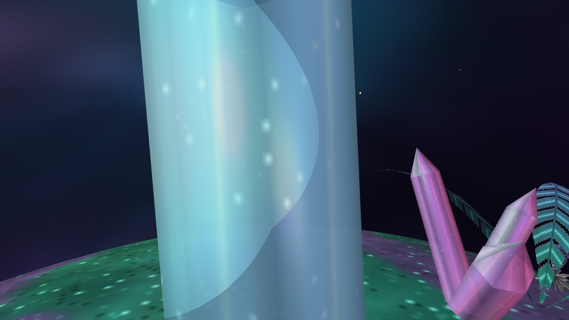
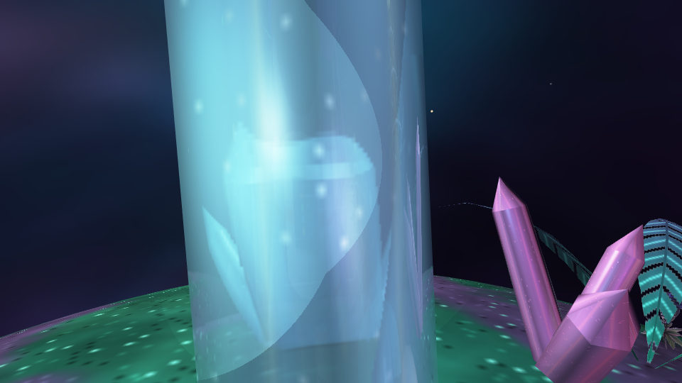
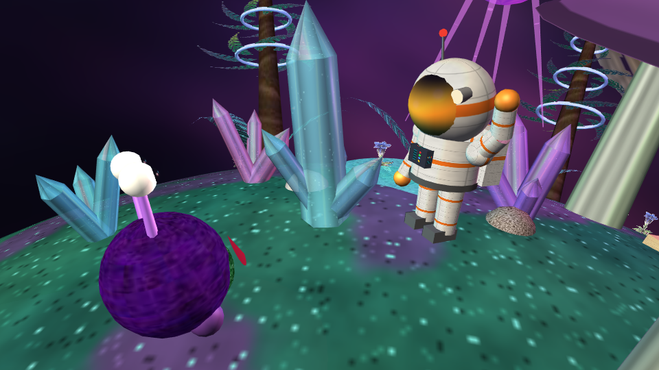
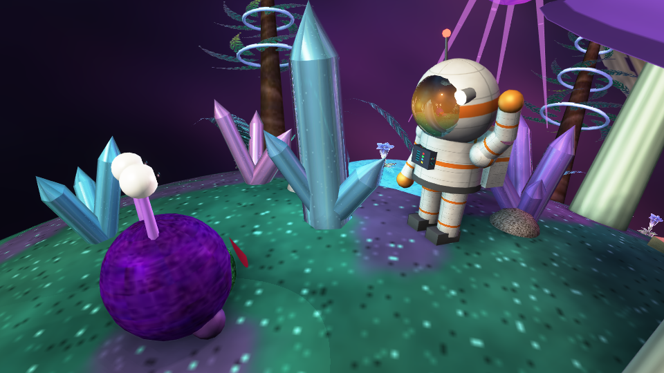

# Modern rendering

Overbryce 2.1 has two renderers.

- **Classic** is the look of 1998: the OpenGL 1.1 fixed-function pipeline (eight lights, fog, sphere-mapped torus), emulated with shaders. It stays the default, and it is what the 1998 sample files were made for.
- **Modern** draws the same scene with techniques that the 1998 hardware could not run in real time:
  - HDR lighting with bloom;
  - soft shadows;
  - ambient occlusion;
  - reflections;
  - refracting glass;
  - glowing materials.

Both run on OpenGL 3.3, so no new hardware requirement was added.

| Classic | Modern |
|---|---|
|  |  |
|  |  |

## Switching

- **In the editor:** *View › Modern rendering* (Ctrl+M) switches the view. The status bar then starts with "Modern". Frame export (Ctrl+E) uses the renderer shown in the view.
- **Per animation:** *Animation › Modern rendering settings* edits the settings below, with a live preview; Cancel restores the previous values. *Open in modern mode* makes the animation open in modern mode.
- **On the command line:** `--modern` or `--classic` overrides the animation's setting for `--snapshot` and `--frames`.

```powershell
Overbryce.exe Scenes\Lumina\Lumina.ani --snapshot lumina.png --time 46 --size 1280x720 --modern
```

## Element properties

Every shape has a new category in the property grid, *9 Modern rendering*. The classic renderer ignores these properties. Like every other numeric property, they are interpolated between key states.

| Property | Range | Default | Effect |
|---|---|---|---|
| Reflectivity | 0..1 | 0 | Mirror reflection of the surroundings, mixed with the material's own colour. It is stronger at grazing angles (Fresnel). |
| Refractive index | ≥ 1 | 1 | Above 1 the element is glass. It bends what is behind it (1.33 water, 1.45–1.5 glass, 2.4 diamond) and reflects more at grazing angles. Its opacity (diffuse alpha) controls how much of its own colour shows. |
| Glow | ≥ 0 | 1 | Multiplies the emission colour. Values above 1 push the colour beyond white, so bloom makes it glow. |
| Casts shadows | yes/no | yes | The element casts shadows. On a **light**, this property is in the *8 Light* category and controls whether the light casts shadows at all. |

**Tips**
- Turn off *Casts shadows* for elements that stand for light sources, such as a lamp bulb or a sun sphere around a point light. Otherwise their surface blocks the light. Elements that enclose a light are skipped automatically.
- Elements with an opacity below 0.5 and glass elements never cast shadows.

## Animation settings

| Group | Setting | Default | Meaning |
|---|---|---|---|
| General | Open in modern mode | off | Show the animation in modern mode when it is opened |
| | Exposure | 1 | Brightness before the highlights are compressed. 1 matches the classic brightness |
| Bloom | On, Strength, Threshold | on, 0.5, 0.9 | Bright parts glow. The threshold is the brightness where the glow starts |
| Shadows | On, Softness, Lights with shadows, Map size | on, 1, 4, 1024 | Soft shadow edge width; up to 4 lights; resolution of a shadow-map face |
| Ambient occlusion | On, Radius, Strength | on, 0.5, 1 | Darker creases and contacts. Radius is in scene units |
| Reflections | On, Probes, Probe size | on, 4, 256 | Reflections and glass. Probes is how many elements get their own view of the surroundings per frame |

## How a frame is drawn

The code is in `src/Overbryce.App/Rendering`: `SceneRenderer.Modern.cs` and `ModernPipeline.cs`. The lighting shader is shared with the classic renderer, in `ShaderProgram.cs`.

1. **Shadow maps.** Up to four lights with *Casts shadows* are chosen per frame. They are ranked by brightness × attenuation at the camera, so the lights that matter in the shot win.
   - Each chosen light renders a cube map of distances. A spot light skips the cube faces outside its cone.
   - The lighting shader samples it with 12-tap percentage-closer filtering and a normal offset. The edge width grows with *Softness* and with the distance from the light.
2. **Reflection probes.** The elements with reflectivity or glass that are largest on screen each get a cube map of their surroundings, drawn from their centre without themselves (up to *Probes*). Other reflecting elements use the nearest probe. The probes are drawn with lighting and shadows but without reflections, so there is one bounce.
3. **Ambient occlusion.** Normals and depth of the opaque elements are drawn first. Screen-space ambient occlusion (16 samples in a hemisphere, 4×4 noise, blurred) darkens creases and contacts. It is applied fully to ambient light and at 40 % to direct light.
4. **Main pass.** The scene is drawn into a 16-bit floating-point buffer with multisampling: 4 samples in the view, 8 for export, none when antialiasing is off in the rendering settings.
   - The lighting is the classic one, with no clamp at 1.
   - Then shadows, occlusion, glow, Schlick-Fresnel reflection and the refraction of glass are added.
5. **Post-processing.** The image is resolved and a dual-filter bloom is applied (6 levels, soft threshold). Then exposure and a tone curve are applied. The curve is the identity up to 0.8 and rolls off to 1, so ordinary colours look as in the classic renderer and only the highlights are compressed.

Picking (clicking objects) and wire-frame mode always use the classic path.

### Cost

Measured on the development laptop at 960×540 (Debug build):

| Pass | Extra time per frame |
|---|---|
| Modern without reflection probes | +2–7 ms |
| With four reflection probes (Lumina at 46 s) | up to about +16 ms (46.8 ms instead of 30.8 ms) |

Turning off reflections, or lowering *Probes* or *Probe size*, is the main way to speed it up.

## Limitations

- **Reflections and refraction** come from cube maps, not from ray tracing.
  - A surface reflects what its probe sees from the centre of the element, so flat mirrors and large surfaces show parallax errors.
  - Glass refracts once and shows the surroundings, not other glass behind it.
  - The [ray tracing plan](raytracing-plan.md) covers exact reflections and refraction for exported frames.
- **Shadows** come from point lights. Their softness is a filter width, not the size of a real light, so the edge does not widen with the distance from the occluder. Half-transparent elements either cast a full shadow (opacity 0.5 or more) or none. White-transparent texture parts do let the light through.
- **Ambient occlusion** sees only what is on screen, so occluders outside the picture do not darken anything.
- **More than four lights:** only the four most important lights cast shadows; the others light the scene without shadows.

## Compatibility

The settings and the element properties are stored in an extension block after `KoniecAnimacie`, the end tag of the original format. The block is described in [ani-format.md](ani-format.md#the-overbryce-21-extension-block).

- **Older programs:** the 1998 program and Overbryce 2.0 stop reading at that tag. They open 2.1 files as before; they do not keep the block when they save.
- **Files without modern data** are written exactly as before.
- **Newer files:** settings and records from a newer version are kept and written back unchanged. Values that cannot be read fall back to the defaults.
- **The classic renderer** gives the same picture as in 2.0 (checked pixel by pixel against the 2.0 build).
