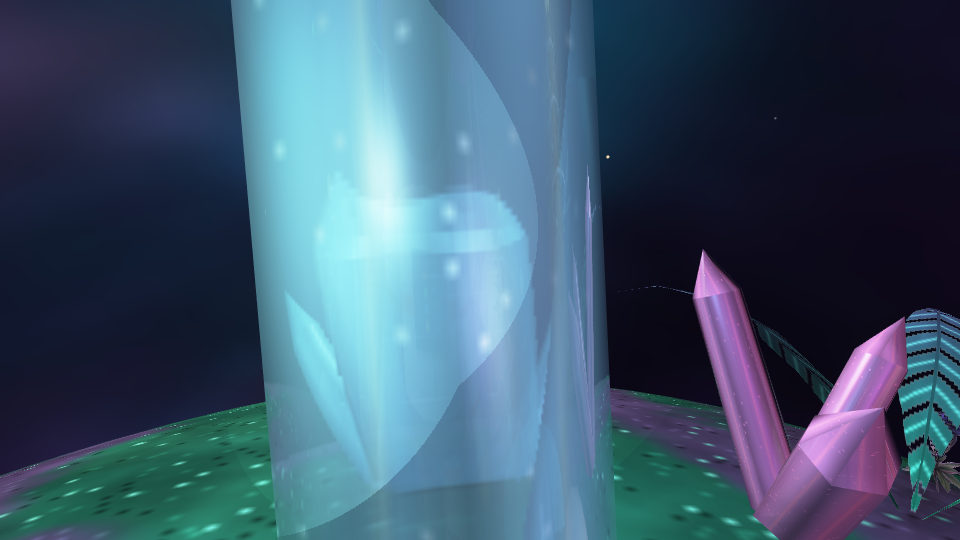
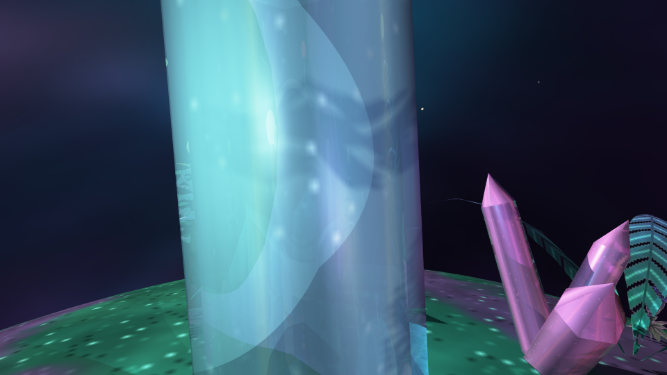
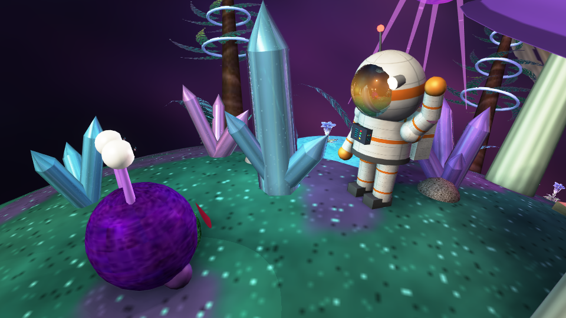
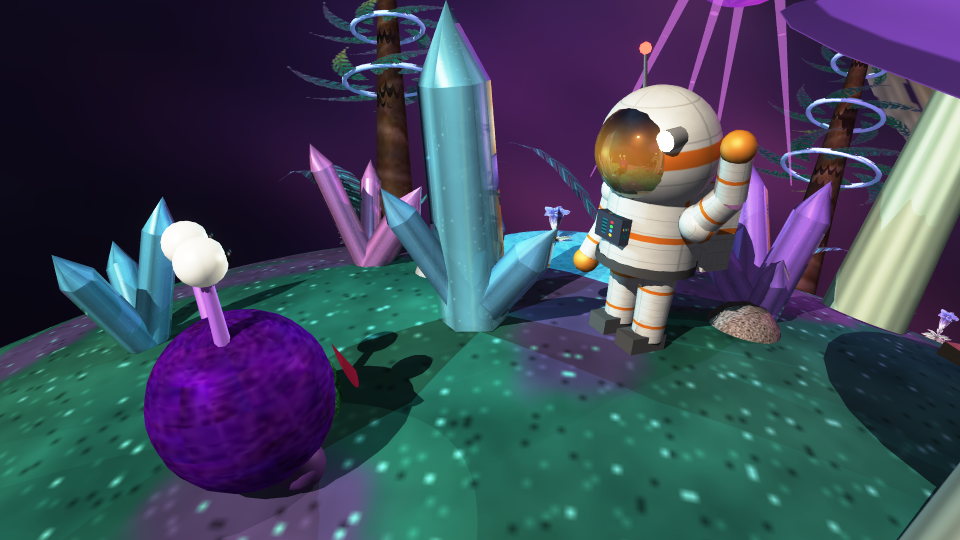

# The ray tracer (Overbryce 2.2)

Overbryce 2.2 adds an offline CPU ray tracer next to the classic and the [modern](modern-rendering.md) real-time renderers. It renders exported frames, snapshots and a preview window with effects the real-time renderers can only approximate:

- reflections of reflections, also in flat mirrors;
- refraction through any number of glass surfaces, with total internal reflection and colour absorption;
- shadows from every light, soft when the light has a size;
- depth of field and motion blur;
- antialiasing with any number of samples per pixel.

| Modern (OpenGL) | Ray traced |
|---|---|
|  |  |
|  |  |

*Lumina at 46 s and 54 s, 960×540. The ray-traced frames use 64 samples per pixel (see *Performance* for times). The glass column refracts the scene behind it, and every light casts shadows.*

The editor's view stays real time. The classic renderer remains the default and the reference for the 1998 look.

## Using it

- **Command line:** `--raytrace` works with `--snapshot` and `--frames`. `--samples N` and `--bounces N` override the animation's settings. With `--classic`, the tracer renders the classic look (see *Parity* below). Each picture is reported on the console.

  ```powershell
  Overbryce.exe Scenes\Lumina\Lumina.ani --snapshot lumina.png --time 54 --size 1280x720 --raytrace --samples 32
  Overbryce.exe Scenes\Lumina\Lumina.ani --frames frames --size 1280x720 --raytrace
  ```

- **Export:** *File › Rendering settings › Export renderer* chooses between *as the view*, *classic*, *modern* and *ray traced* for *File › Export frames*. Esc cancels as before, also in the middle of a traced frame.
- **Preview:** *View › Ray trace this view* (F9) traces the current state or timeline position through the current camera into its own window. The picture is refined pass by pass (1, 2, 4 … samples per pixel) and can be saved. The window shows a snapshot of the view when F9 was pressed; F9 again traces the view as it is now.
- **Settings:** *Animation › Ray tracing settings* edits the settings stored with the animation:

| Setting | Default | Meaning |
|---|---|---|
| Samples per pixel | 16 | rays per pixel (1–4096); more give smoother edges, soft shadows, glossy reflections, depth of field and motion blur |
| Bounces | 6 | how many reflections and refractions a ray follows (0–32) |
| Geometry | faceted | *faceted*: the triangles of the OpenGL view; *smooth*: exact spheres, cones, disks and tori |
| Shadows | on | lights cast shadows (each light and element can opt out with *Casts shadows*) |
| Ambient occlusion | off | creases and contacts get less ambient light, found with rays |
| Occlusion rays / distance | 4 / 0.5 | rays per sample and how far they look |
| Shutter | 0 | how long the shutter is open, as a part of a frame (0 = no motion blur) |
| Steps | 3 | how many times within the shutter the animation is evaluated |

Exposure, bloom and the tone curve come from the modern rendering settings, so a ray-traced frame and a modern frame of the same scene look alike.

New element properties (in the property grid):

| Property | Where | Default | Meaning |
|---|---|---|---|
| *Roughness* | element, *9 Modern rendering* | 0 | spreads reflections into glossy ones and makes glass frosted |
| *Absorption* | element, *9 Modern rendering* | 0 | how strongly a closed glass element tints the light per scene unit travelled inside it, towards its diffuse colour (Beer–Lambert; 0 = clear) |
| *Radius* | light, *8 Light* | 0 | the size of the light: above 0 its shadows get soft edges, wider the farther they fall; at 0, a glowing element around the light lightens the shadows of small elements (see *Glowing light bodies*) |
| *Aperture* | camera | 0 | radius of the lens: above 0, what is not at the focus distance is blurred |
| *Focus distance* | camera | 10 | the distance from the camera that is sharp |

All of them are interpolated between key states, so a focus pull or a light growing softer animates by itself. The existing 2.1 values (reflectivity, refractive index, glow, casts shadows) mean the same as in the modern renderer.

## How it works

```text
Overbryce.Core          model, interpolation, transforms, .ani + extension block
  └ Geometry/           the tessellation shared by the OpenGL renderers and the tracer
Overbryce.Raytrace      scene compiler, BVH, shapes, shading, sampling, film, post-processing
Overbryce.App           UI and OpenGL; RaytraceBridge connects the tracer to views, export and textures
```

`Overbryce.Raytrace` needs only `Overbryce.Core` and .NET itself: no OpenGL, no WinForms and no new packages. Textures reach it through a delegate; the App decodes them with the same rules as the OpenGL views (stretched to 128×128, pure white transparent).

### Geometry

- **Shared tessellation.** The vertex builder of the OpenGL renderers moved from the App to `Overbryce.Core/Geometry`. The tracer intersects exactly the triangles OpenGL draws, with the same interpolated normals and texture coordinates. The classic renders did not change by the move.
- **Smooth mode** replaces spheres, cones (`gluCylinder`, no caps), disks (with hole and sweep) and tori with exact surfaces. The torus is found by sphere tracing its exact distance function. Boxes, rectangles, triangles and Bezier meshes stay triangles.
- **Shared shapes.** Each shape is built once at unit size (a unit sphere, a cone of base radius 1 and height 1, a disk of outer radius 1 …) and placed with a scale matrix. Normals go through the inverse transpose, so they come out as OpenGL computes them. Equal shapes of different sizes share one BVH, and a cache keeps the shapes between the frames of an export.
- **Acceleration.** Each shape has a BVH built with the binned surface area heuristic. A second BVH over the elements is rebuilt for every frame, and rays go into each element's own space through its inverse matrix.
- **Facets and shadows.** Shadow rays start from the point lifted onto the smooth surface the vertex normals describe (Hanika's "Hacking the shadow terminator", 2021), so coarse facets do not shadow themselves. Convex elements (spheres, boxes, flat shapes) skip their own shadow test.

### Shading

Each hit is lit with the fixed-function OpenGL formulas of the shaders, in the same order: the emission, the global ambient 0.2, then per light the attenuation, the spot cone and exponent, the ambient, the diffuse N·L and the Blinn–Phong specular with exponent shininess × 128. Lighting is one-sided as in the original. The first eight lights are used, as OpenGL had GL_LIGHT0..7. The torus is sphere mapped from the eye-space ray and normal, and fog uses the eye depth.

On top of that, in the full look:

- **Glow** multiplies the emission, and colours are not clamped (HDR) until the tone curve. The exception is the modern setting *Classic texture lighting* (on unless the file turns it off): the light on a textured surface is clamped at 1 before the texture is applied, as in OpenGL 1.1 and the modern renderer, so the 1998 scenes are not washed out.
- **Shadows:** a ray to each light that casts shadows; only elements that cast shadows block. Glass and half-transparent elements tint the light instead of blocking it, and white texels let it through. A light with a radius is sampled over a disk facing the point, one ray per sample, which gives physically soft shadows. An element whose bounding sphere contains a light does not shadow it, so lamps, suns and glowing crystals shine out. The modern renderer's shadow maps use the same rule.
- **Glowing light bodies:** a light without a radius often sits inside a glowing element: a sun, a bulb. As a point, it would make a small element next to it throw a huge hard shadow far away (a moon passing the sun would black out half a planet). So the smallest glowing element centred on the light (emission × glow at least 0.5, centre within half its size of the light; the modern renderer's rule) counts as the light's body. A glowing element with other, unlit elements inside it is a sky, a halo or a room around the light, not its body. An element that looks smaller than that body from the shaded point hides only part of it: its shadow is lightened by the ratio of the two apparent sizes, squared. Elements close to the shaded point still hide the whole body, so characters keep their shadows. This costs nothing and adds no noise; for real penumbras, give the light a radius.
- **Reflection:** a mirror ray weighted by reflectivity and Schlick's Fresnel term, the same mix as the modern renderer. Roughness spreads the ray.
- **Glass** (refractive index above 1 and alpha below 1): closed shapes (sphere, box, torus) refract by Snell's law on the way in and out, with total internal reflection and Beer–Lambert absorption inside. Open and flat shapes (cones, disks, rectangles, meshes) are thin sheets, and the light passes straight through. The mix of what is seen through, the surface itself and the reflection is that of the modern renderer.
- **Negligible values are off.** Interpolating between key states that all hold a default gives values such as a refractive index of 1.0000001; such values snap back to the default, so a half-transparent halo does not turn into glass. Reflectivity and refractive index count only above 0.001 (`Element.IsReflective`, `Element.IsGlass`, shared with the modern renderer).
- **Transparency** (alpha below 1 without glass, with alpha blending on) continues the ray straight through and blends as `glBlendFunc(SRC_ALPHA, ONE_MINUS_SRC_ALPHA)`. It follows the OpenGL renderers' drawing order: they draw the elements in scene order with depth writes on, so whatever they draw after a see-through surface and behind it is not seen. The tracer skips such hits too, down to the order of the triangles within an element. Scenes made in the editor therefore look the same: nested halos keep their brightness, and a light column drawn before the ground hides it. Glass is not affected; it refracts.
- **Ambient occlusion** (optional) uses cosine-distributed rays over a short distance and darkens only the ambient terms, as the modern renderer does.
- A ray stops after *Bounces* reflections or refractions, or when its contribution falls below 0.4 %.

There is no light bouncing between diffuse surfaces (global illumination). It would change the 1998 look; the emission of the elements plays that role.

### Camera, sampling and film

- **Samples** are deterministic: each pixel, sample and frame has its own random sequence, and pixel positions follow the R2 low-discrepancy sequence. The same frame always gives the same picture, on any number of threads. With 1 sample per pixel the ray goes through the pixel centre, as OpenGL samples.
- **Depth of field:** rays start on a thin lens of the given aperture and meet at the focus distance.
- **Motion blur:** the animation is evaluated at *Steps* times within the shutter, centred on the frame time. Each sample picks a time, and the element and camera matrices are interpolated between the two nearest steps. Elements are matched between the steps by their name path. Lights, fog and materials are those of the frame time. Fast spins need more steps.
- **Film and post-processing:** samples are summed in floating point. The full look then adds the modern renderer's bloom (the same dual filter with soft knee, six levels from half size), exposure and the shoulder that keeps everything up to 0.8 and rolls the rest off towards 1. The classic look clamps each sample to 0..1, as the classic renderer's frame buffer does.
- **Threads:** 16×16 pixel tiles on all processors with `Parallel.For`; progress per tile and cancelling with a `CancellationToken`.

## Parity with the classic renderer

`--raytrace --classic` renders the classic look through the tracer: the OpenGL lighting clamped to 0..1, no glow, shadows, reflections or refraction. This pins the tracer to the OpenGL renderer: the lighting, fog, textures, transforms and camera must agree. Measured at 960×540 against `--classic` (OpenGL, 8× multisampling), with 16 samples per pixel:

| Sample | Mean difference (0–255) | Pixels differing by more than 8 |
|---|---|---|
| Gule | 0.02 | 0.1 % |
| Meshe | 0.12 | 0.3 % |
| Disky | 0.19 | 0.8 % |
| Mesto | 0.71 | 0.8 % |
| ha1 | 0.72 | 0.8 % |
| Scena | 0.98 | 2.3 % |
| NewAni | 0.83 | 1.7 % |
| Lumina at 2 s (the sun and its halo) | 0.22 | 0.1 % |
| Lumina at 14 s | 0.29 | 0.1 % |
| Lumina at 46 s | 0.36 | 0.7 % |
| Lumina at 54 s | 1.0 | 2.7 % |

The differences are on silhouettes (another antialiasing) and on the edges of cut-out textures such as the flowers. Inside the surfaces the pictures agree, see-through layers included, because the tracer follows OpenGL's drawing order (see *Transparency* above). Before it did, blending every layer in depth order made Lumina's sun halo about twice as bright as in OpenGL (a mean difference of 3.4 at 2 s and 5.1 at 14 s).

The tessellation moved from the App to `Overbryce.Core.Geometry` so that the OpenGL renderers and the tracer share it. The classic and modern OpenGL pictures of the samples are the same as before the move.

## Performance

Measured at 1280×720 on 16 threads (Release build):

| Frame | Look | Samples | Time |
|---|---|---|---|
| Gule, 3 elements | full | 16 | 0.5 s |
| NewAni, 23 elements, 5,838 triangles | full | 16 | 1.9 s |
| Lumina at 54 s, 326 elements, 57,256 triangles, 7 lights | full | 16 | 12 s |
| Lumina at 46 s, mostly glass | full | 16 | 23 s |
| Lumina at 54 s | classic | 1 | 1.3 s |

These times were measured on an otherwise idle machine before the final changes to transparency and to shadows from glowing light bodies. Compared under the same load, those changes stayed within the run-to-run variation (up to about 20 %). The time grows linearly with the samples per pixel and the number of pixels. Every light that casts shadows adds a shadow ray per hit, and glass and mirrors add rays per bounce.

## File format

The settings and values are optional keys in the [extension block](ani-format.md#the-overbryce-21-extension-block), written only when they differ from the defaults:

| Record | Key | Default | Meaning |
|---|---|---|---|
| `Raytrace` | `samples` | 16 | samples per pixel |
| | `bounces` | 6 | maximum number of reflections and refractions |
| | `geometry` | `faceted` | `faceted` or `smooth` |
| | `shadows` | 1 | shadows on |
| | `ao`, `aoRays`, `aoDistance` | 0, 4, 0.5 | ray-traced ambient occlusion |
| | `shutter`, `blurSteps` | 0, 3 | motion blur |
| `Element` | `roughness` | 0 | glossy reflection, frosted glass |
| | `absorption` | 0 | absorption in glass per scene unit |
| `Element` on a light | `lightRadius` | 0 | size of the light |
| `Element` on a camera | `aperture`, `focus` | 0, 10 | depth of field |

Compatibility is as in 2.1:

- the 1998 program and Overbryce 2.0 stop reading before the block;
- Overbryce 2.1 keeps the unknown record and keys and writes them back when it saves;
- a key that does not belong to the element's type (`lightRadius` on a sphere, say) is kept, not applied;
- files without the new keys are written exactly as before.

## Limitations

- **Wire-frame elements** (*Draw style: Line*) are not traced. None of the samples uses them.
- **Global illumination** and a denoiser are not part of this version.
- **Glass in open shapes** (a cone, a disk) is a thin sheet, because the shape has no inside.
- **The preview** is a separate window with a snapshot of the view, not a refinement in place.
- **Packets and SIMD traversal** are not used: single rays with `System.Numerics` were fast enough for the samples.

## Tests

`tests/Overbryce.Raytrace.Tests` checks:

- the intersections of every shape (hits, misses, starts inside, the disk's hole and sweep, the torus's hole);
- the BVH against testing every triangle on random rays;
- faceted against smooth geometry;
- the classic lighting formulas at a known point, spot cones and clamping;
- shadows, the opt-out per element, soft edges from a light radius, glass shadows, lights inside elements, and small elements next to a glowing light body;
- cut-out textures, half-transparent blending, the OpenGL drawing order of see-through layers, and mirrors (which the classic look ignores);
- motion blur, depth of field and determinism (the same picture twice and on one thread).

`tests/Overbryce.Core.Tests` checks the round trip of the new keys, that default values add nothing to the file, and that default surface values stay exact between unevenly spaced key states.
