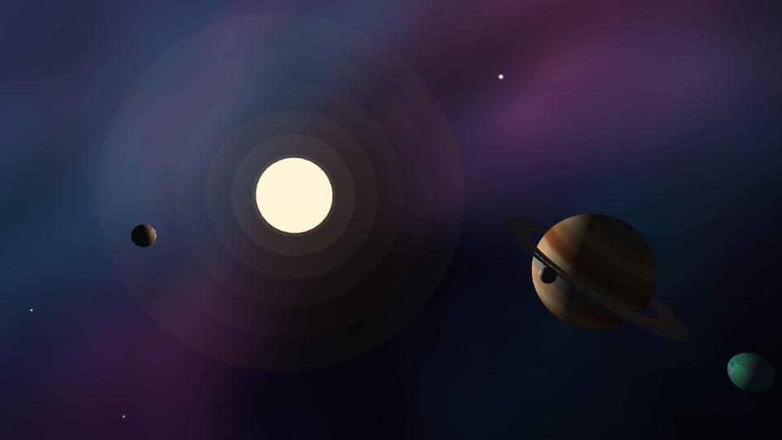
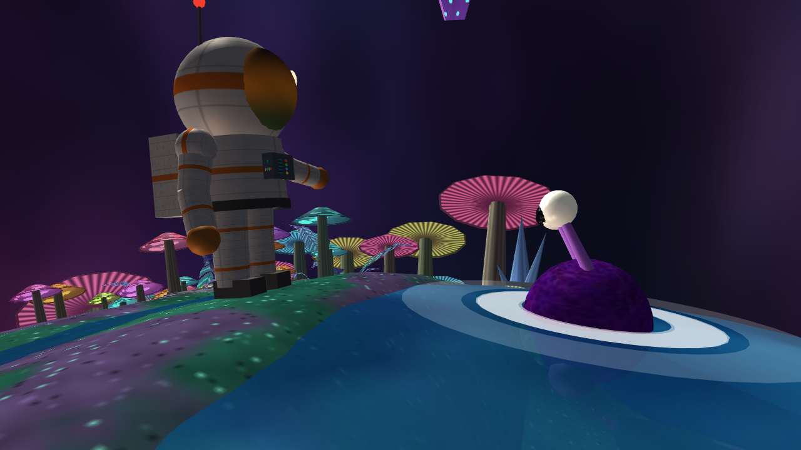
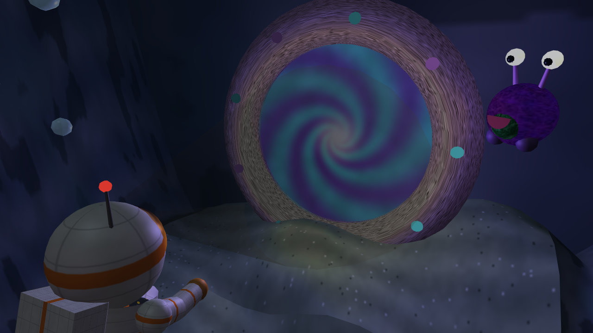

# Lumina

A 121-second animation made with Overbryce for the port. It opens on a planetary system seen from afar: a ringed gas giant circles its sun, and the small moon Lumina and a moonlet circle the giant. A lander comes in from deep space, shoots past the camera and heads for Lumina.

On the moon it touches down, and an astronaut walks down the ramp and hops through a forest of glowing fungi, ferns and spinning-ring trees. Jellyfish drift and manta-like fliers circle overhead. The astronaut touches a crystal, which flares up, and meets one of the locals.

The creature then leads him across the moon, which is covered in jungle: groves of trees, fungi and crystals over a carpet of undergrowth, with a large ocean in the southern hemisphere. The mantas follow them. At the shore the creature leaps into the sea and beckons; he wades in and dives. Under the surface lies a world of its own: a slope down into a canyon with kelp, anemones, starfish, fish schools, a ray and deep jellyfish. The daylight fades, his helmet lamp comes on, and they end in front of a glowing portal in the canyon wall.


| | |
|---|---|
|  |  |
|  |  |
|  |  |

The [contact sheet](../../docs/images/lumina-contact-sheet.png) has sixteen stills, from the opening to the portal.

Open it in the editor (*File › Open › Lumina\Lumina.ani* next to `Overbryce.exe`), or render it from the `Port` folder:

```powershell
dotnet run --project src\Overbryce.App -- samples\Lumina\Lumina.ani --frames out\Lumina --size 1280x720
```

## The story and its cameras

| Time (s) | Camera | What happens |
|---|---|---|
| 0–5.5 | `VKamera` | The system from afar: the sun, an inner rocky planet, the giant on its orbit, Lumina and the moonlet around the giant |
| 5.5–10.5 | `VKamera` | The camera turns to deep space, where a blinking light grows into the lander and shoots past just over the camera |
| 10.5–16 | `VKamera` | A whip pan catches it again within a second, then follows its engine glow towards Lumina |
| 16–24 | `KamVesmir` | Close to Lumina: the moon, the giant and its moonlet; the lander comes in on a curved approach |
| 24–29 | `KamZostup` | The legs unfold; touchdown at 28.5 s with a *Stop at this state* key; dust ring; the engine dies |
| 29–37 | `KamDvere` | The mast extends and the dish starts scanning; the door swings down into a ramp; the astronaut walks out and waves |
| 37–45 | `KamSled` | A tracking shot of four low-gravity hops along the path |
| 45–48 | `KamPrilba` | Through the helmet visor: something pops up behind the crystals |
| 48–52 | `KamObjav` | He steps up to the heart crystal, crouches and touches it; it flares and the spores burst out |
| 52–55 | `KamStretnutie` | He steps back, turns to the creature and waves |
| 55–64.5 | `KamFinale` | They hop together while the camera cranes out until the whole moon is in view, then swings towards the ocean as the two set off |
| 64.5–67.5 | `KamPrilba` | First person: following the creature through the jungle; the mantas sweep low over him and fly on ahead |
| 67.5–71.5 | `KamCesta` | A tilted tracking shot along the route: the manta flock glides in from the sky and over the pair |
| 71.5–74.5 | `KamRameno` | Over his shoulder: the mantas come from behind, sweep over him as he looks up, and fly on along the way |
| 74.5–77.5 | `KamPole` | A high shot over the jungle as they cross a clearing |
| 77.5–81.5 | `KamBreh` | Low over the water: they reach the shore; the creature leaps |
| 81.5–85 | `KamPozvanie` | It splashes into the sea, turns back and beckons; he waves back and walks in |
| 85–87 | `KamPrilba` | First person: wading out; he dives at 86.1 s and the sea fog closes in |
| 87–91 | `KamHladina` | Under the surface, in shafts of light: the two swim down together |
| 91–95 | `KamPrilba` | First person: following the creature down towards the canyon, past a fish school |
| 95–100 | `KamSvah` | Down the slope into the canyon, past kelp and rocks |
| 100–104 | `KamKanon` | Between the canyon walls; the light fades to teal |
| 104–107 | `KamPrilba` | First person in the dusk; the helmet lamp flickers on at 105.6 s |
| 107–112 | `KamLuc` | Over his shoulder: the lamp lights the anemones and starfish on the canyon floor |
| 112–115.5 | `KamPrilba` | First person: the portal comes into view in the canyon wall, the creature beside it |
| 115.5–121 | `KamPortal` | They stop in front of the portal; the creature nods towards it |

The opening is a miniature of the story's world at about 1/8 scale, with its own sky and camera. The sky sphere travels with that camera, so the system can be up to 95 units away; Overbryce's far plane is at 100. The story's elements first appear in the key state at 16 s, and the intro's last key state is one frame earlier, so the cut is clean.

The moon comes in two versions. The close-up story from 24 to 55 s keeps the original bare moon with its own fungi and crystals. The wide shots before and after it show the jungle moon with its ocean; the switch happens at camera cuts, so it is never seen. The cut into the depths at 87 s is a *motion boundary*: both key states at the cut stop every spline, so the astronaut and the creature can keep their element names in the new world without being dragged across it.

Under water the clear colour would show through the fog, so a large sphere in the fog colour surrounds the scene. The fog grows denser and darker as they descend, and the lamp is a spot light in the helmet: with a soft edge (a high exponent and a wide cutoff). In the last shot a translucent cone also shows the beam. It is left out wherever the camera is inside the cone or close beside it, where it would read as a flat sheet hanging in front of the lens.

## Hierarchical motion

Most of the motion comes from nested groups. Each group rotates about its parent's origin, so a joint is a translated group with a rotated group inside it:

- **The system in the opening:** orbits are translated groups with a permanent rotation, so they carry their children round in a circle.
  - `VObrDraha` (the giant's orbit around the sun) › `VObrOs` › `VObrNaklon` (axial tilt), with the planet and rings inside. `VObrOs` turns back by the same angle as `VObrDraha`, so the axis keeps its direction in space.
  - Inside the tilt, `VMesiacDraha` (Lumina) and `VDrobecDraha` (the moonlet) orbit the giant in the plane of its rings, at their own periods.
  - The flying lander is `VSonda` (position) › `VSondaSmer` (heading) › `VSondaNaklon` (pitch) › `VSondaRot` (a slow permanent roll). Inside is the story's lander, scaled down with its legs folded.
- **Astronaut**, 9 levels down to a glove: `AstroRig` (place on the moon) › `Astronaut` (height, heading) › `Panva` (pelvis drop) › `Trup` (lean, twist) › `RamenoLKlb` › `RamenoL` (swing, raise) › `LaketLKlb` › `LaketL` (elbow, wave) › `RukavicaL`. The legs, head and helmet lamp work the same way. The helmet camera `KamPrilba` sits in the head, so the point of view follows the head's turns.
- **Lander:** `LanderMiesto` › `Lander` (flight path) › `LanderTrup` (attitude), with these groups inside:
  - four leg hinges that unfold;
  - the door hinge, which turns the door into a ramp;
  - a telescopic mast › `Antena` (permanent rotation) › `AntenaMisa` (tilt).
- **Manta flock:** `Kridla` (tilted orbit plane) › `KridlaRot` (permanent rotation around the moon) › `MantaKolo` › `Manta` › `MantaTelo` (banking). The wings are Bezier meshes that flap.
- **Gas giant:** `ObrSystem` › `ObrNaklon` (axial tilt) with the spinning planet, its rings and the moonlet `Drobec` on a permanent orbit.
- **Fungi and trees:** whole mushrooms sway about their foot. A spinning spore group sits inside each swaying mushroom. Whorls of fern fronds spin around the trees in alternate directions. They are flat disks with a pinwheel texture: a torus would not do, because Overbryce sphere-maps a torus's texture, which follows the view direction rather than the object, so a spinning torus looks still.
- **Placement:** every object stands in an anchor group turned to the moon's surface normal, so its own Y axis points up wherever it is on the sphere. The journey's cameras sit in such anchors too, so they stay upright as they travel round the moon; `KamCesta` is tilted on purpose.
- **Under water:** the astronaut swims in `AstroRigV` (position) › `AstroSmer` (heading) › `AstroSklon` (pitch) › `Astronaut`, which puts the glove eleven levels down.

Key states are 0.04 to 1 s apart, closer where the motion is fast, 247 in all. Overbryce's time-aware Catmull-Rom spline fills in the 3,025 frames in between.

The manta flock that follows the pair changes its element names at two camera cuts, with a key state one frame before each, the same way as the cut from the opening. Each of its three sweeps can then start where its shot needs it. On so small a moon the ground under a manta a few units away is tilted by tens of degrees, so in the tracking shot the mantas fly level with the camera's ground rather than their own, or they would look rolled on edge.

The jungle has about 2,700 elements in the busiest key state. To keep the file and the rendering manageable, the generator samples the cameras every 0.1 s and at every key state, and leaves out each scenery group that no camera sees between a key state and the next: outside the view, beyond the fog, or behind the moon's horizon. The file is about 37 MB. The jungle shots render at roughly 10 frames per second, so the editor plays them slower than real time; rendered to video, the film runs at full speed.

## Textures

None were downloaded. They come from two sources:

- **From the 1998 samples (`DIP/SCENES`):**
  - `Horec` (flowers) and `Hriby` (toadstools)
  - `Ryby` (the fossil slab)
  - `Voda` (the pond)
  - `TmaveDrevo` (tree trunks)
  - `ModroRuzovyMramor` (the hoops on the trees)
  - `FialovyMramor` and `ZelenyMramor` (the creature)
  - `SivyKamen`, `DrsnyKamen` and `Pieskovec` (rocks)
  - `Folia`: the lander's gold foil, tinted from `Papier`
- **Painted by `tools/Lumina`** with tileable value noise:
  - sky and moon: the nebula, the gas giant and its rings, the moon surface and the moss;
  - astronaut and lander: the suit, visor, chest panel, hull panels, mission badge and flame;
  - flora: the mushroom caps, gills and stems, the fern fronds, and the frond whorls on the trees (`Praslen`);
  - fauna and effects: the crystals, the manta wings, the jellyfish and the dust;
  - the jungle and the sea: the undergrowth (`Podrast`), the ocean, the moon seen from afar with its jungle and ocean (`PovrchMore`);
  - the depths: the seabed, the canyon rock, kelp, fish, starfish, the portal's swirl and the lamp's beam.

Pure white is transparent in Overbryce. The fern, flower, badge, ring and dust textures use it for their outlines.

## Regenerating

The scene is described in code, in [tools/Lumina](../../tools/Lumina):

| File | Content |
|---|---|
| `Intro.cs` | The opening: the miniature system, the lander's flight and the camera that follows it |
| `Story.cs` | The actors, cameras and timing on the moon; `Build(t, offset)` returns the key state at story time `t` |
| `Journey.cs` | The walk to the ocean: the paths, the gaits, the manta flock's sweeps, the leap, the wading and the dive, and the journey's cameras |
| `Planet.cs` | The jungle moon: terrain, ocean, the route to the shore, and the flora grown in colonies and carpets around the cameras' sightlines |
| `SpherePath.cs` | A smooth path over the moon's surface, measured in ground units |
| `Depths.cs` | The underwater world: the canyon, its flora and fauna, the swimmers, the lamp and the portal |
| `Culling.cs` | Leaves out scenery that no camera sees |
| `Kit.cs` | Helpers for materials, placement on the moon, camera aiming and easing curves |
| `Textures.cs` | The procedural textures |

```powershell
dotnet run --project tools\Lumina
```

This rewrites `Lumina.ani` and the textures in this folder.
