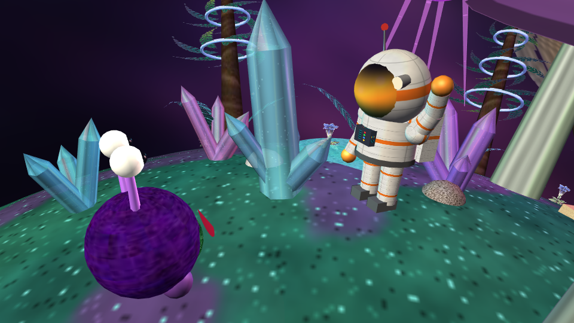
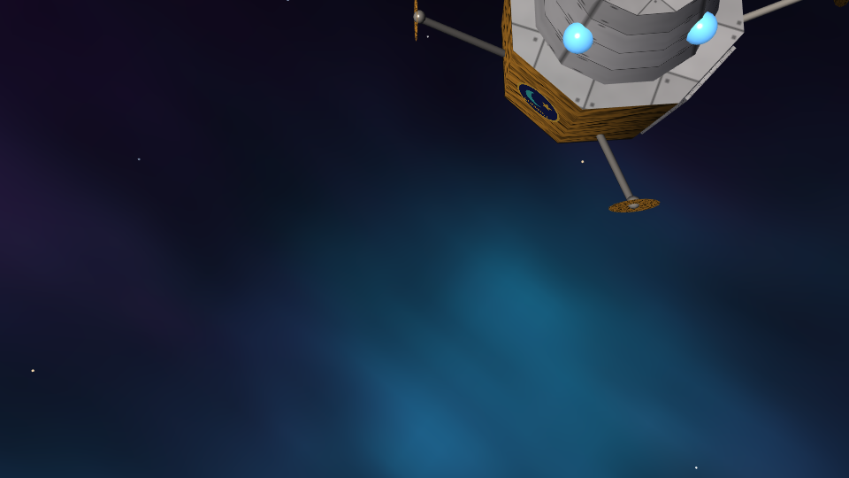
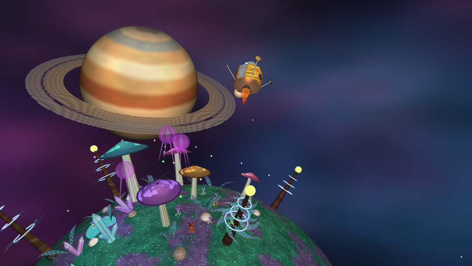
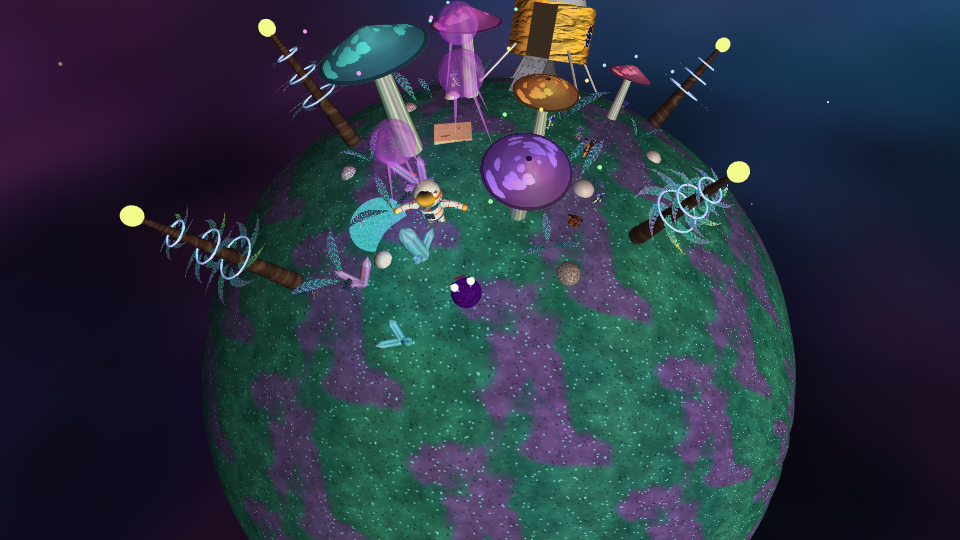

# Lumina

A 64-second animation made with Overbryce for the port. It opens on a planetary system seen from afar: a ringed gas giant circles its sun, and the small moon Lumina and a moonlet circle the giant. A lander comes in from deep space, shoots past the camera and heads for Lumina.

On the moon it touches down, and an astronaut walks down the ramp and hops through a forest of glowing fungi, ferns and spinning-ring trees. Jellyfish drift and manta-like fliers circle overhead. The astronaut touches a crystal, which flares up, and meets one of the locals.



| | |
|---|---|
|  |  |
|  |  |

The [contact sheet](../../docs/images/lumina-contact-sheet.png) has twelve stills, from the opening through the finale.

Open it in the editor (*File › Open › Lumina\Lumina.ani* next to `Overbryce.exe`), or render it from the `Port` folder:

```powershell
dotnet run --project src\Overbryce.App -- samples\Lumina\Lumina.ani --frames out\Lumina --size 1280x720
```

## The story and its cameras

| Time (s) | Camera | What happens |
|---|---|---|
| 0–5.5 | `VKamera` | The system from afar: the sun, an inner rocky planet, the giant on its orbit, Lumina and the moonlet around the giant |
| 5.5–10.5 | `VKamera` | The camera turns to deep space, where a blinking light grows into the lander and shoots past just over the camera |
| 10.5–16 | `VKamera` | A whip pan catches it again within a second, then follows its engine glow towards Lumina |
| 16–24 | `KamVesmir` | Close to Lumina: the moon, the giant and its moonlet; the lander comes in on a curved approach |
| 24–29 | `KamZostup` | The legs unfold; touchdown at 28.5 s with a *Stop at this state* key; dust ring; the engine dies |
| 29–37 | `KamDvere` | The mast extends and the dish starts scanning; the door swings down into a ramp; the astronaut walks out and waves |
| 37–45 | `KamSled` | A tracking shot of four low-gravity hops along the path |
| 45–48 | `KamPrilba` | Through the helmet visor: something pops up behind the crystals |
| 48–52 | `KamObjav` | He steps up to the heart crystal, crouches and touches it; it flares and the spores burst out |
| 52–55 | `KamStretnutie` | He steps back, turns to the creature and waves |
| 55–64 | `KamFinale` | They hop together while the camera cranes out until the whole moon is in view |

The opening is a miniature of the story's world at about 1/8 scale, with its own sky and camera. The sky sphere travels with that camera, so the system can be up to 95 units away; Overbryce's far plane is at 100. The story's elements first appear in the key state at 16 s, and the intro's last key state is one frame earlier, so the cut is clean.

## Hierarchical motion

Most of the motion comes from nested groups. Each group rotates about its parent's origin, so a joint is a translated group with a rotated group inside it:

- **The system in the opening:** orbits are translated groups with a permanent rotation, so they carry their children round in a circle.
  - `VObrDraha` (the giant's orbit around the sun) › `VObrOs` › `VObrNaklon` (axial tilt), with the planet and rings inside. `VObrOs` turns back by the same angle as `VObrDraha`, so the axis keeps its direction in space.
  - Inside the tilt, `VMesiacDraha` (Lumina) and `VDrobecDraha` (the moonlet) orbit the giant in the plane of its rings, at their own periods.
  - The flying lander is `VSonda` (position) › `VSondaSmer` (heading) › `VSondaNaklon` (pitch) › `VSondaRot` (a slow permanent roll). Inside is the story's lander, scaled down with its legs folded.
- **Astronaut**, 9 levels down to a glove: `AstroRig` (place on the moon) › `Astronaut` (height, heading) › `Panva` (pelvis drop) › `Trup` (lean, twist) › `RamenoLKlb` › `RamenoL` (swing, raise) › `LaketLKlb` › `LaketL` (elbow, wave) › `RukavicaL`. The legs, head and helmet lamp work the same way. The helmet camera `KamPrilba` sits in the head, so the point of view follows the head's turns.
- **Lander:** `LanderMiesto` › `Lander` (flight path) › `LanderTrup` (attitude), with these groups inside:
  - four leg hinges that unfold;
  - the door hinge, which turns the door into a ramp;
  - a telescopic mast › `Antena` (permanent rotation) › `AntenaMisa` (tilt).
- **Manta flock:** `Kridla` (tilted orbit plane) › `KridlaRot` (permanent rotation around the moon) › `MantaKolo` › `Manta` › `MantaTelo` (banking). The wings are Bezier meshes that flap.
- **Gas giant:** `ObrSystem` › `ObrNaklon` (axial tilt) with the spinning planet, its rings and the moonlet `Drobec` on a permanent orbit.
- **Fungi and trees:** whole mushrooms sway about their foot. A spinning spore group sits inside each swaying mushroom. Whorls of fern fronds spin around the trees in alternate directions. They are flat disks with a pinwheel texture: a torus would not do, because Overbryce sphere-maps a torus's texture, which follows the view direction rather than the object, so a spinning torus looks still.
- **Placement:** every object stands in an anchor group turned to the moon's surface normal, so its own Y axis points up wherever it is on the sphere.

Key states are 0.25 to 1 s apart, closer where the motion is fast, 118 in all. Overbryce's time-aware Catmull-Rom spline fills in the 1,600 frames in between.

## Textures

None were downloaded. They come from two sources:

- **From the 1998 samples (`DIP/SCENES`):**
  - `Horec` (flowers) and `Hriby` (toadstools)
  - `Ryby` (the fossil slab)
  - `Voda` (the pond)
  - `TmaveDrevo` (tree trunks)
  - `ModroRuzovyMramor` (the hoops on the trees)
  - `FialovyMramor` and `ZelenyMramor` (the creature)
  - `SivyKamen`, `DrsnyKamen` and `Pieskovec` (rocks)
  - `Folia`: the lander's gold foil, tinted from `Papier`
- **Painted by `tools/Lumina`** with tileable value noise:
  - sky and moon: the nebula, the gas giant and its rings, the moon surface and the moss;
  - astronaut and lander: the suit, visor, chest panel, hull panels, mission badge and flame;
  - flora: the mushroom caps, gills and stems, the fern fronds, and the frond whorls on the trees (`Praslen`);
  - fauna and effects: the crystals, the manta wings, the jellyfish and the dust.

Pure white is transparent in Overbryce. The fern, flower, badge, ring and dust textures use it for their outlines.

## Regenerating

The scene is described in code, in [tools/Lumina](../../tools/Lumina):

| File | Content |
|---|---|
| `Intro.cs` | The opening: the miniature system, the lander's flight and the camera that follows it |
| `Story.cs` | The actors, cameras and timing on the moon; `Build(t, offset)` returns the key state at story time `t` |
| `Kit.cs` | Helpers for materials, placement on the moon, camera aiming and easing curves |
| `Textures.cs` | The procedural textures |

```powershell
dotnet run --project tools\Lumina
```

This rewrites `Lumina.ani` and the textures in this folder.
