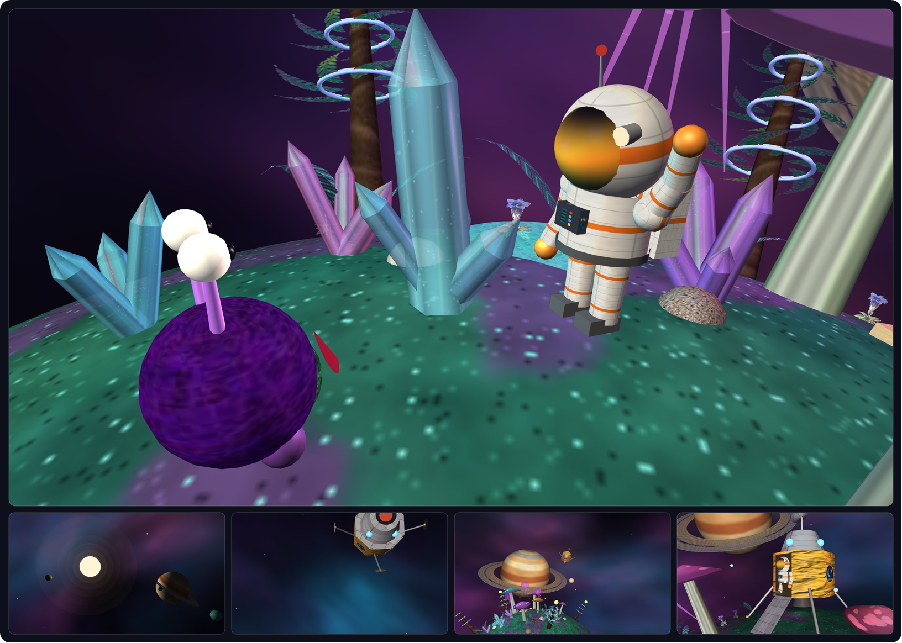

# Overbryce Animator: diploma thesis, 1998, and .NET 10 port



*[Lumina](Port/samples/Lumina/README.md), a 121-second animation made in Overbryce's own 1998 file format and rendered by the port.*

This repository holds the program from a 1998 diploma thesis and a current port of it:

- **Thesis:** *Simulácia virtuálnej reality pomocou OpenGL – animácia scény* (Simulating virtual reality with OpenGL – scene animation)
- **Author:** Tomáš Kopečný
- **Faculty:** Faculty of Electrical Engineering and Information Technology, Slovak University of Technology (FEI STU), Bratislava
- **Submitted:** December 1998

The thesis designs and implements **Overbryce Animator**. It is a Windows editor for key-frame 3D animation: OpenGL scenes are built from primitives, lights and cameras, and every attribute is interpolated between key states with a non-uniform Catmull-Rom spline.

## Contents

| Folder | Content |
|---|---|
| [`Port/`](Port/README.md) | **Overbryce Animator 2.0**: the port to .NET 10, WinForms and OpenGL 3.3, with tests and documentation. Start here |
| `DIP/SOURCE/` | Original C++ source code (Borland C++ Builder 3, VCL, OpenGL 1.1 and GLU). Kept unchanged |
| `DIP/SCENES/` | Original sample animations (`*.ani`) and textures. The port loads them in its tests and copies them next to its executable |

The files in `DIP/` are kept byte-for-byte as they were on the original CD. The Slovak texts are encoded in Windows-1250.

The thesis text, its figures and the original design documents are not part of this repository.

## Quick start

You need Windows 10 or 11, the [.NET 10 SDK](https://dotnet.microsoft.com/download) and a GPU with OpenGL 3.3. Then run:

```powershell
cd Port
```

```powershell
dotnet run --project src\Overbryce.App -- "..\DIP\SCENES\NewAni.ani"
```

See [Port/README.md](Port/README.md) for the controls, and [Port/docs](Port/docs) for the animation model, the file format, and how the port differs from the 1998 program. Also there:

- [how the port was made](Port/docs/port-overview.md), in brief;
- an [evaluation of the thesis](Port/docs/thesis-evaluation.md), by the standards of its time.

## License

No license has been chosen yet. Until one is added, all rights are reserved by the author.
